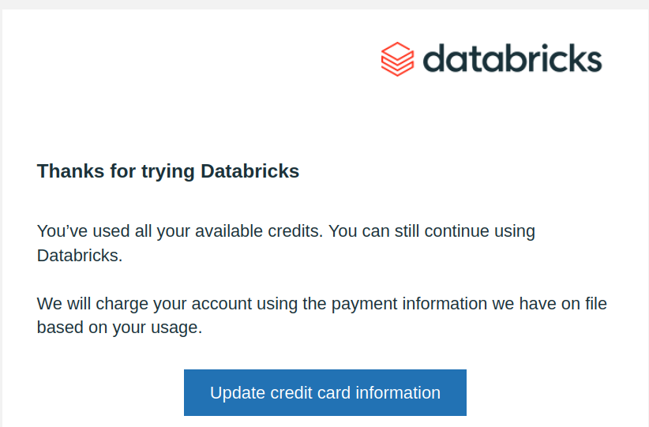

# Where the $400 of trial credits went

**Question (Ryan, 2026-11-02):** the Databricks trial credits are exhausted after one afternoon of
hill climbing on the eval. What accounts for that?

**Answer in one line:** the agent's Unity Catalog function calls. Every call to a
`workforce.semantic.*` table function goes through the managed MCP functions server, which runs
each call on serverless general compute at all-purpose serverless rates ($0.75/DBU), so cost grows
with every call. Genie, called through the same agent, runs on the SQL warehouse, whose cost is flat
with volume. Per call the two paths cost about the same today; the bill is four times as many
function calls as Genie questions, and one eval question (C11) fires about 30 function calls per
run and is two thirds of them.



## What the billing table shows

`system.billing.usage` joined to `system.billing.list_prices`, list price, workspace total through
2026-11-02 22:00 UTC (the table lags about three hours):

| SKU | DBU | USD | What it is |
|---|---|---|---|
| All-purpose serverless compute | 214 | $160.53 | UC function calls via the MCP functions server, run as the `workforce-agent` service principal, tagged `interactive_source = DATABRICKS_CONNECT` |
| Serverless real-time inference | 259 | $18.15 | Genie's own charge (`product_features.genie.offering_type = PAYGO`), billed because the caller is a service principal |
| Serverless SQL warehouse | 24 | $17.05 | Genie's queries, 1,113 of them, on the 2X-Small warehouse |
| Jobs, storage | 4 | $1.05 | ingest |

By day: $7.64 (Oct 31), $12.47 (Nov 1), $176.68 (Nov 2, through 22:00 UTC). The audit log shows
the service principal kept calling functions at the 21:00 UTC rate (65 DBU/hour, about $49/hour)
until 00:03 UTC on Nov 3. Two more hours at that rate puts the list-price total near $300. The
account console is authoritative for the rest; the join reconciles (214 × 0.75, 259 × 0.07,
24 × 0.70), so the gap is lag or console accounting, not the query.

## The mechanism

Databricks documents that Unity Catalog functions exposed by the managed MCP server run on
serverless general compute and bill at that rate, while the Genie server bills on serverless SQL
compute ([managed MCP](https://docs.databricks.com/generative-ai/mcp/managed-mcp/),
[Azure doc with the billing table](https://learn.microsoft.com/azure/databricks/agents/mcp-tools/managed-mcp)).
The [cost estimate](build-cost-estimate.md) saw this coming on 2026-10-30: "UC functions called as
agent tools run on serverless generic compute (Spark Connect), not the SQL warehouse ... confirm
the SKU the MCP functions server bills to on day one." It estimated "a few dollars for 75-run eval
passes". The SKU was never confirmed, and the climb ran 1,720 runs, not 75.

Measured from `system.access.audit` (`managedMcp.mcpRequest` rows with `mcp_method = TOOLS_CALL`)
against the hourly billing rows:

| Hour (UTC, Nov 2) | UC tool calls | DBU | USD per call |
|---|---|---|---|
| 18:00 | 263 | 32.0 | $0.09 |
| 19:00 | 212 | 42.5 | $0.15 |
| 20:00 | 529 | 60.1 | $0.09 |
| 21:00 | 1,240 | 65.1 | $0.04 |

Through 22:00 UTC, the billed window: about 2,340 function calls for $160.53, $0.07 per call on
average. Through 00:03 UTC, when the calls stopped: about 4,800 calls. Billing rows per hour
exceeded calls per hour in the early hours, so idle session time was billed on top of the queries.
The per-call price falls as calls pack more densely into sessions.

Genie for comparison, same billed window: about 560 `query_space` calls cost $17 of warehouse time
plus $18 of Genie charge, $0.06 per question. Per call the two paths are close. The difference is
the pricing model and the volume. The warehouse's $17 is 24 DBU over three days whatever the query
count, and would barely have grown had the function calls gone through it too; serverless general
compute bills per session, so four times the calls is four times the money.

## One question is most of the bill

`plan_variance` was called 4,445 times through 00:03 UTC; the next function,
`length_of_service_profile`, 127 times. Grouping `challenge/eval/experiments.jsonl` by question (86
recorded runs each, 4,025 `plan_variance` calls recorded; the audit count is higher because the
harness incident lost a pair of experiments):

| Row | Verbatim | `plan_variance` calls per run | Share of recorded `plan_variance` calls |
|---|---|---|---|
| C11 | "Add up the first three quarters of FY2026: how far behind plan is each component on hiring?" | 31.5 | 67% |
| C02 | "Which components missed their hiring plan by the most in the first quarter of FY2026?" | 10.3 | 22% |
| C03 | | 3.8 | 8% |
| all other rows | | 0 to 1 | 3% |

The function takes one quarter and one component, so the agent answers C11 by calling it once per
component per quarter. The [eval journal](../../challenge/eval/journal.md) saw the same fan-out from
the other side in iteration 4: "about 45 concurrent calls to the functions server" causing C11's
errors. C11 alone is roughly $90 of the compute.

## Why nobody saw it coming

The journal reports cost per iteration at $0.42 to $0.48 and $2.68 for the whole climb. That is
the harness's `cost_usd` field, which counts model tokens only. Databricks compute was never
measured, and no budget alert existed on the account.

## Is it still running?

No audit events from the service principal after 00:03 UTC on Nov 3 as of a 01:04 UTC query, and no
harness process on Ryan's machine. The audit table lags, so this is very likely stopped, not
certainly. The email above arrived about an hour after the last call.

## What it changes

With the credits gone, every further run is charged to the card on file, against the
[under-$50 budget](build-cost-estimate.md). One iteration pair (200 runs) at today's call mix is
about $16 of function compute alone. Levers, in order of effect:

1. **Give `plan_variance` a multi-quarter, all-components form** so C11 is one call, not 30, and
   C02 one call, not 10. This removes about 90% of the function volume at no cost to the agent.
2. **Route function calls through the SQL warehouse** (Statement Execution API) instead of the MCP
   functions server. The 2X-Small warehouse is a flat 4 DBU/hour (about $2.80) however many calls
   it serves, and already auto-stops at five minutes. The trade is the managed MCP story in the demo
   narrative; see [Databricks in mission environments](databricks-in-mission-environments.md) for why
   the MCP path was chosen.
3. **Run fewer runs per iteration.** The journal's own noise analysis says two experiments of 100
   runs are needed to see a change beyond noise; there is no cheaper number without changing the
   statistic. Prefer lever 1.
4. **Put a budget alert on the account** before the next run; the
   [cost estimate](build-cost-estimate.md) covers how.

Genie's $18 charge exists because the agent calls Genie as a service principal; the cost estimate
noted human users are free through 2027-01-31. It is small and not worth changing the auth model
for.

## How to reproduce the numbers

All from the workspace's `workforce` SQL warehouse through the Statement Execution API:

```sql
-- dollars by SKU
SELECT u.sku_name, round(sum(u.usage_quantity),2) dbu,
       round(sum(u.usage_quantity*p.pricing.default),2) usd
FROM system.billing.usage u
LEFT JOIN system.billing.list_prices p
  ON u.sku_name=p.sku_name AND u.cloud=p.cloud
 AND u.usage_start_time>=p.price_start_time
 AND (p.price_end_time IS NULL OR u.usage_start_time<p.price_end_time)
GROUP BY 1 ORDER BY usd DESC;

-- tool calls by hour, from the audit log
SELECT date_trunc('hour',event_time) h, request_params.tool_name, count(*)
FROM system.access.audit
WHERE action_name='mcpRequest' AND request_params.mcp_method='TOOLS_CALL'
GROUP BY 1,2 ORDER BY 1,3 DESC;
```

The per-question fan-out comes from `experiments.jsonl` locally: count `tool_calls` whose name
contains `plan_variance`, grouped by `id`.
